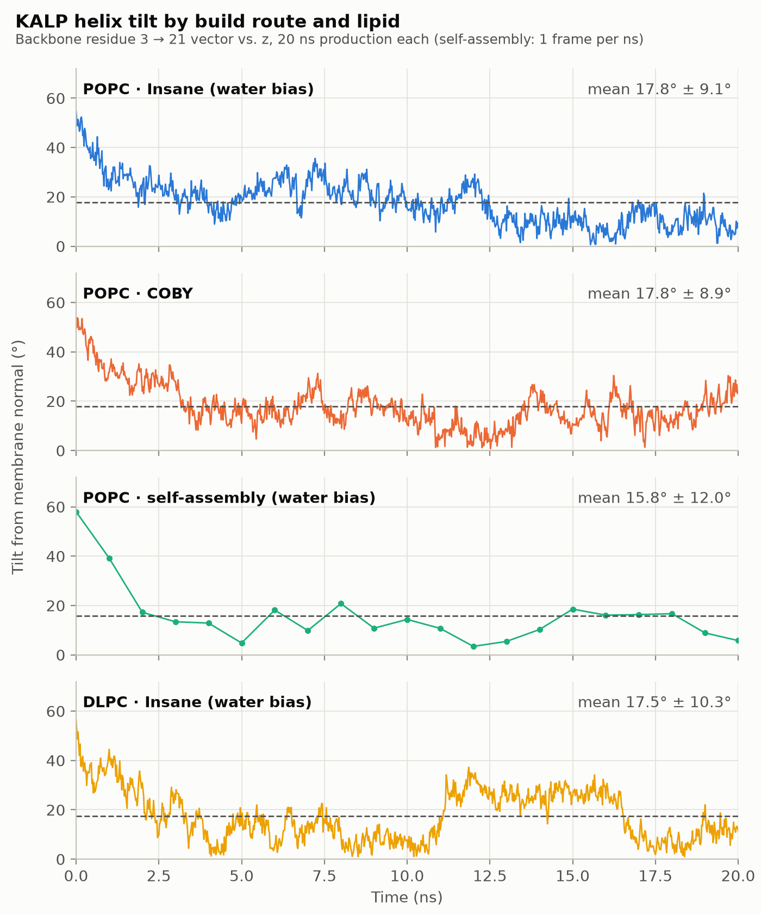
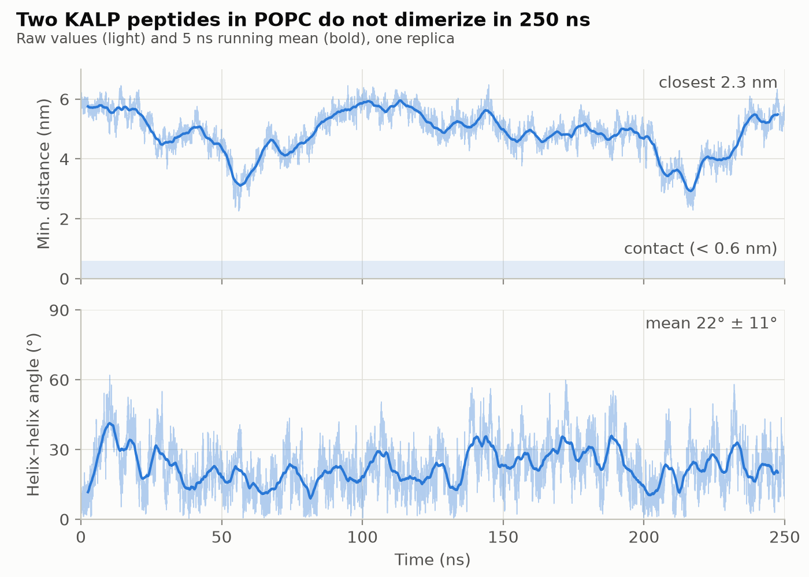

# Transmembrane peptides (KALP)

Reproduction of [Proteins IIa – Setting up transmembrane peptide simulations](https://cgmartini.nl/docs/tutorials/Martini3/ProteinsIIa/) tutorial for Martini3

This tutorial covers:

1. Coarse-graining a transmembrane peptide with `martinize2`, with and without water biasing
2. Building the membrane system in four different ways (self-assembly, `Insane`, `COBY` and `TS2CG`)
3. Measuring the tilt of the peptide in the bilayer
4. Two extra exercises: a thinner DLPC bilayer and a KALP dimer

The system is a single 23-residue KALP peptide (a Leu/Ala helix capped with lysines, charge +4) in a 7 × 7 nm POPC bilayer. The all-atom structure (`kalp-AA.pdb`) comes in the tutorial zip.

Results:

-  `Insane`, `COBY` and `TS2CG` all settle the tilt at ~15° (3–20 ns), as they use the same starting coordinates.
- The starting orientation does matter for 20 ns runs, though. A TS2CG run started upright averaged 27°
- DLPC is ~0.5 nm thinner than POPC, but the tilt stayed at ~15°
- Two KALP peptides didn't dimerize in 250 ns. The closest they got was 2.3 nm

GROMACS 2022.2, one replica per system.
___
### Working Directory

Separated in folders, since most of them produce files with the same names (`system.gro`, `system.top`, `dynamic.xtc`, ...). Analyses done/saved in `analysis/`.

```
ii-transmembrane-proteins/
├── kalp-AA.pdb            all-atom structure, from the tutorial zip
├── peptide-martinize/     martinize2, plain Martini3
├── water-bias/            martinize2 with water biasing
├── self-assembly/         bilayer self-assembly
├── insane/                pre-built bilayer with Insane (main route)
├── coby/                  pre-built bilayer with COBY
├── ts2cg/                 pre-built bilayer with TS2CG 2.0
├── dlpc/                  KALP in DLPC
├── dimer/                 two KALP peptides
├── analysis/              index files, .xvg files and plotting scripts
└── figures/               plots used in this README
```

Besides GROMACS, we need `vermouth` (for `martinize2`), `insane` and `COBY`, all installable with `pip`. TS2CG 2.0 is installed with `pip install git+https://github.com/weria-pezeshkian/TS2CG-v2.0`. The plotting scripts use `numpy` and `matplotlib`.

The tutorial files can be downloaded [here](https://cgmartini-library.s3.ca-central-1.amazonaws.com/0_Tutorials/m3_tutorials/ProteinsII/KALP_ProteinsII_Tutorial.zip). The zip has `kalp-AA.pdb`, the Martini3 `.itp` files, `POPC.gro`, `water.gro` and the `minimization`/`equilibration`/`dynamic.mdp` files (the tutorial page itself doesn't show the `.mdp` contents, bear that in mind).

___

### CG-ing the peptide

In `peptide-martinize/`:

```
martinize2 -ff martini3001 -f ../kalp-AA.pdb -x kalp.pdb -p backbone -o system.top \
  -ss CCHHHHHHHHHHHHHHHHHHHCC
```

This is plain Martini3 with a fixed secondary structure. A single helix doesn't need an elastic network or Gō model. The page writes the `-ss` string twice, and one of them has one fewer `C` at the end, so check that it's 23 characters long.

#### Water biasing (optional)

The tutorial calls this a "last resort": it adds a bias that keeps short peptides from leaving the membrane or lying flat on its surface. In `water-bias/`, run the same command with `-water-bias -water-bias-eps E:-.5 C:1.0 H:-1.0` added. This writes `virtual_sites_atomtypes.itp` and `virtual_sites_nonbond_params.itp` (don't rename them).

Then add this to `martini_v3.0.0.itp`, between `[ atomtypes ]` and `[ nonbond_params ]` (around line 858):

```
#ifdef WBIAS
#include "virtual_sites_atomtypes.itp"
#include "virtual_sites_nonbond_params.itp"
#endif
```

and put `#define WBIAS` at the top of `system.top`.

Do this on a **local copy** of `martini_v3.0.0.itp`, not the shared one in `martini_v300/`. If the tutorial's `sed` command runs twice, it inserts the block twice.

The water-biased peptide has 73 beads (one extra `CA` bead per residue), against 50 for the plain one. This matters later for the tilt analysis.

___
### Self-assembly

In `self-assembly/`, place the peptide and 156 POPC randomly in a box, then solvate, as follows:

```
gmx editconf -f ../water-bias/kalp.pdb -o kalp.gro -d 1.5
gmx insert-molecules -f kalp.gro -ci POPC.gro -nmol 156 -box 7 7 6 -try 500 -o system_no-solvent.gro
gmx editconf -f system_no-solvent.gro -o system_no-solvent.gro -c -box 7 7 10
gmx solvate -cp system_no-solvent.gro -cs water.gro -o system_solvated.gro -radius 0.21
```

Write a `system.top` including the Martini, peptide, phospholipid, solvent and ion `.itp` files, with `molecule_0 1`, `POPC N` and `W N` under `[ molecules ]`. The counts can be taken from the `.gro`:

```
echo $(( $(grep -c POPC system_solvated.gro)/12 ));  grep -c W system_solvated.gro
```

Neutralize the system (this adds 4 Cl⁻):

```
gmx grompp -f minimization.mdp -p system.top -c system_solvated.gro -r system_solvated.gro -o ions.tpr
echo W | gmx genion -s ions.tpr -p system.top -neutral -o ions.gro
```

Minimization, equilibration, index and production:

```
gmx grompp -f minimization.mdp -c ions.gro -r ions.gro -p system.top -o minimization.tpr
gmx mdrun -deffnm minimization -v
gmx grompp -f equilibration.mdp -c minimization.gro -r minimization.gro -p system.top -o equilibration.tpr
gmx mdrun -deffnm equilibration -v
gmx make_ndx -f equilibration.gro -o index.ndx      # same input as for Insane, below
gmx grompp -f dynamic.mdp -c equilibration.gro -p system.top -n index.ndx -o dynamic.tpr
gmx mdrun -deffnm dynamic -v
```

The tutorial suggests isotropic pressure coupling while the bilayer forms, then switching to semi-isotropic, with separate thermostat groups for solvent, membrane and protein. In our case, the run kept isotropic coupling and a single thermostat group (`tc-grps = System`) for the whole 100 ns of production (oops, but it assembled fine). The index is only used for `comm-grps = Membrane Solvent`.

___

### Insane (main route)

In `insane/`, starting from the water-biased peptide (`insane/kalp.gro` is the same file as `self-assembly/kalp.gro`):

```
insane -f kalp.gro -o system.gro -p system.top -pbc square -box 7,7,9 \
  -l POPC -u POPC -center -sol W -salt 0.01
```

Insane needs some fixing afterwards:

1. In `system.gro` and `system.top`, rename `NA+`/`CL-` to `NA`/`CL`
2. In `system.top`, replace `#include "martini.itp"` with the block below, and rename `Protein` to `molecule_0` under `[ molecules ]` (how `martinize2` calls the peptide):

```
; because we're using water biasing.
#define WBIAS

#include "../water-bias/martini_v3.0.0.itp"
#include "../water-bias/molecule_0.itp"
#include "../../../martini_v300/martini_v3.0.0_phospholipids_v1.itp"
#include "../../../martini_v300/martini_v3.0.0_solvents_v1.itp"
#include "../../../martini_v300/martini_v3.0.0_ions_v1.itp"
```

Minimization:

```
gmx grompp -f minimization.mdp -p system.top -c system.gro -o minimization.tpr
gmx mdrun -deffnm minimization -v
```

Create an `index.ndx` file grouping the peptide with the lipids (`Membrane`) and the water with the ions (`Solvent`), to fit the `tc-grps` in the `.mdp` files. Check that the new groups come out as 16 and 17 before naming them:

```
gmx make_ndx -f minimization.gro << EOD
1|13
14|15
name 16 Membrane
name 17 Solvent
q
EOD
```

Equilibration and production, which give `dynamic.tpr` and `dynamic.xtc`:

```
gmx grompp -f equilibration.mdp -p system.top -c minimization.gro -r minimization.gro -n index.ndx -o equilibration.tpr
gmx mdrun -deffnm equilibration -v
gmx grompp -f dynamic.mdp -p system.top -c equilibration.gro -n index.ndx -o dynamic.tpr
gmx mdrun -deffnm dynamic -v
```
___

### COBY

In `coby/`, with `../peptide-martinize/kalp.pdb` copied in. This one uses the plain 50-bead peptide, without water biasing. The default solvation adds 0.15 M NaCl (26 NA and 30 CL here).

```python
import COBY
COBY.COBY(
    box=[7, 7, 9],
    box_type="rectangular",
    membrane="lipid:POPC",
    protein="file:kalp.pdb moleculetypes:molecule_0",
    solvation="default",
    itp_input=[
        "include:../../../martini_v300/martini_v3.0.0.itp",
        "include:../../../martini_v300/martini_v3.0.0_ions_v1.itp",
        "include:../../../martini_v300/martini_v3.0.0_phospholipids_v1.itp",
        "include:../../../martini_v300/martini_v3.0.0_solvents_v1.itp",
        "include:../peptide-martinize/molecule_0.itp",
    ],
    sn="SimpleMembrane",
    out_sys="system.gro", out_top="system.top", out_log="log.log",
)
```

The page gives no MD commands for this route, so reuse the Insane ones. I ended up keeping the default `make_ndx` group names, so the `.mdp` files in `coby/` use `tc-grps = Protein_POPC W_ION` instead of `Membrane Solvent`.

___

### TS2CG 2.0

Had a lot of problems with this one to be honest; might revisit or stick to Insane.

In `ts2cg/`:

1. Make `kalp.gro` and change its first line to `KALP`, because the name has to match the protein name in `input.str` (manually, or):

```
gmx editconf -f kalp.pdb -o kalp.gro
sed -i '' '1s/.*/KALP/' kalp.gro
```

TS2CG places the peptide in whatever orientation the `.gro` has. Here the helix is tilted ~55° from z, the same as in the Insane and COBY routes, which keeps the tilt comparison fair (see the tilt analysis). To start it upright instead, align it first with `gmx editconf -princ` and then `-rotate 0 90 0`.

2. Write `input.str`:

```
include kalp.gro

[Lipids List]
Domain      0
POPC        1   1   0.64
End

[Protein List]
KALP 1   0.3   0   0   -1.9
End

[Shape Data]
ShapeType    Flat
Box    7    7    9
Density      2     2
Thickness    3.8
WallRange    0     1    0    1
End
```

3. Build the membrane:

`TS2CG PCG -str input.str -LLIB Martini3.LIB -defout system -function analytical_shape`

`Martini3.LIB` comes from the TS2CG repo (`Tutorials/tut1/files/`). Without `-LLIB`, I believe TS2CG falls back to a built-in Martini2 library, where the POPC tail beads are `G1A G2A D3A D4A` instead of the Martini3 `C1A D2A C3A C4A`, and `grompp` complains about it a lot.

In the `[Protein List]` line, the third field (`0.3`) is a ratio: TS2CG places `membrane area / protein area × ratio` copies of the peptide, rounded down, where the protein area is the circle around the peptide seen from above. The tilted KALP covers ~10.3 nm², so anything between 0.25 and 0.4 gives exactly one peptide (the tutorial's draft value of 0.01 gives zero). An upright helix covers only ~1.8 nm² and needs ~0.05. The last field (`-1.9`) moves the peptide down by 1.9 nm; without it, the peptide is centered on the upper leaflet instead of the middle of the bilayer. TS2CG also removes lipids around the peptide, which leaves 70 POPC in the upper leaflet and 68 in the lower one. The tutorial does say to finetune the numbers a bit until it works.

4. Minimize the membrane in vacuum before solvating. This one is important: TS2CG builds each POPC only ~0.6 nm long, so the two leaflets start with an empty gap between them. Use a topology with only the peptide and the lipids (`vacuum.top`):

```
gmx grompp -f minimization.mdp -c system.gro -p vacuum.top -o vacuum.tpr
gmx mdrun -deffnm vacuum -v
```

The minimization stretches the lipids to ~1.8 nm, but the phosphate layers still end up ~5 nm apart instead of ~4.

5. Solvate:

`TS2CG SOL -in vacuum.gro -o solvated_TS2CG-SOL.gro -tem water.gro`

SOL's output has two problems. First, it fills the leftover gap between the leaflets with water: here, 498 of the 1828 water beads. Delete every `W` bead between the two phosphate (PO4) planes. My first attempt skipped step 4 and ended up with 942 water beads in the core; the membrane split in two during equilibration and the peptide tumbled freely. Second, SOL cuts every atom name to 2 characters (`SC1` → `SC`, `PO4` → `PO`), so `grompp` complains about mismatched names. Keep the names from `vacuum.gro`.

6. Write `system.top`. TS2CG's version has no `#include` lines and calls the peptide `KALP`, while the `martinize2` `.itp` calls it `molecule_0`. Set the `W` count to SOL's count minus the water removed from the core, then neutralize the +4 charge:

```
gmx grompp -f minimization.mdp -c solvated.gro -p system.top -o genion.tpr
echo W | gmx genion -s genion.tpr -o ions.gro -p system.top -pname NA -nname CL -neutral
```

7. Minimize, equilibrate and run production as in the Insane route, starting from `ions.gro`. The `make_ndx` input is the same (selecting the groups by name also works):

```
"Protein" | "POPC"
"W" | "ION"
name 16 Membrane
name 17 Solvent
q
```

Over 3–20 ns of production, the bilayer was 3.86 ± 0.05 nm thick (phosphate to phosphate), the same as the Insane and COBY runs, with at most 7 water beads left in the core.

___

### Analysis – Tilt

The tilt is the angle between the z-axis (normal) and a vector going from the backbone (`BB`) bead of residue 3 to the `BB` bead of residue 21. The atom numbers of those beads depend on the peptide model:

| Route | Peptide model | Beads | `make_ndx` selection |
|---|---|---|---|
| Insane | water bias (`water-bias/`) | 73 | `a 9 63` |
| COBY | plain (`peptide-martinize/`) | 50 | `a 7 43` |
| TS2CG | plain (`peptide-martinize/`) | 50 | `a 7 43` |

The tutorial's `a 7 43` only works for the 50-bead peptide. In the water-biased peptide, atoms 7 and 43 are side-chain beads (Lys 2 `SC2` and Leu 14 `SC1`). For Insane:

```
gmx make_ndx -f ../insane/dynamic.tpr -o insane_index.ndx     # a 9 63, then q
gmx gangle -f ../insane/dynamic.xtc -s ../insane/dynamic.tpr -g1 vector -group1 a_9_63 \
  -g2 z -n insane_index.ndx -oall insane-angles.xvg -rmpbc
xmgrace insane-angles.xvg
```

For COBY and TS2CG, use `a 7 43` and `-group1 a_7_43`.

`gmx gangle` gives angles around 160° because the vector points down along z, so the tilt is 180° minus the angle. Using the wrong pair (7–43) on the Insane run gives a tilt ~2° lower than the right one (9–63).

`python3 plot_tilt.py` plots all of them into `figures/tilt.png` (the bottom panel is the DLPC run, see below).



| Route | Tilt at start | Mean, full run | Mean, 3–20 ns |
|---|---|---|---|
| Insane (water bias) | 51° | 17.8° ± 9.1° | 15.7° ± 7.3° |
| COBY | 52° | 17.8° ± 8.9° | 15.1° ± 5.8° |
| TS2CG | 58° | 18.1° ± 9.8° | 15.2° ± 5.9° |

All three start from the peptide as written by `gmx editconf` and `martinize2`, tilted 50–60° from z, and relax within ~3 ns, so the last column leaves those out. After that, all three sit at ~15°, so the way the membrane is built doesn't change the tilt. The Insane run uses water biasing and the other two don't, which made no visible difference here either.

The starting orientation, on the other hand, does matter for runs this short. An earlier TS2CG run started with the helix along z (~10° tilt) and averaged 27.0° ± 7.4° over 3–20 ns, ~12° more than the others, even though its bilayer had the same thickness and area per lipid. Starting from the same tilted structure removed the difference. With single 20 ns runs, it's better to compare routes from the same starting structure, or to run repeats with different starting velocities.
___
### Going further: KALP in DLPC

The tutorial gives no commands for this part. The idea is to rebuild the system with DLPC (12:0, shorter tails) instead of POPC (16:0–18:1), simulate it under the same conditions and see how the membrane thickness affects the tilt. A thinner bilayer means a hydrophobic mismatch with the peptide, which could make it tilt more.

I used the Insane route, so the POPC Insane run is the reference: same peptide (water bias), same starting orientation, same box and same `.mdp` files.

1. Set up the folder:

```
mkdir dlpc && cd dlpc
cp ../insane/kalp.gro ../insane/minimization.mdp ../insane/equilibration.mdp ../insane/dynamic.mdp .
```

2. Insane has no Martini3 DLPC (`ERROR lipid name M3.DLPC not found`), so we need a `lipids.dat` again. Copy the `[ diacylglycerol ]` template from Insane's own `lipids.dat` and add one line. Martini3 DLPC has 3 tail beads per chain (same layout as Insane's `M3.DMPC`), with bead names matching `martini_v3.0.0_phospholipids_v1.itp`:

```
[ diacylglycerol ]
           0  .5   0   0  .5   0   0  .5   0   0   0   0   0   0   1   1   1   1   1   1
           0   0   0   0   0   0   0   0   0   0   0   0   0   0   0   0   0   0   0   0
          10   9   9   8   8   7   6   6   5   4   3   2   1   0   5   4   3   2   1   0
M3.DLPC   0   -   -   -  NC3  -  PO4 GL1 GL2 C1A C2A C3A  -   -   -  C1B C2B C3B  -   -   -
```

Careful not to reuse `01_multicomponent-membrane/lipids.dat` here! The two Martini3 lipid files use the name `DLPC` for different lipids:

| File | `DLPC` is | Tail beads |
|---|---|---|
| `martini_v3.0.0_phospholipids_v1.itp` (used here) | dilauroyl, 12:0 (same model as DMPC, 14:0) | `C1A C2A C3A`, 3 saturated |
| `martini_v3.0.0_phospholipids_PC_v2.itp` (used in tutorial 01) | dilinoleoyl, 18:2 (called `DIPC` in v1) | `C1A D2A D3A C4A`, 4 with two double-bond beads |

Tutorial 01 needed the liquid 18:2 lipid, and its `lipids.dat` matches the v2 file. Here we want the thinner 12:0 lipid, so we use the v1 file and the 3-bead entry above (and don't include `phospholipids_PC_v2.itp` in this topology).

3. Build the system with the same command as for POPC, swapping the lipid and adding `-dat`:

```
insane -f kalp.gro -o system.gro -p system.top -pbc square -box 7,7,9 \
  -l DLPC -u DLPC -center -sol W -salt 0.01 -dat lipids.dat
```

This gives 77 + 78 DLPC, ~2277 W and 4 CL.

4. Fix `system.top` like for POPC: same `#define WBIAS` and `#include` block, and `Protein` renamed to `molecule_0`. The ions already come out as `CL`, and the v1 phospholipid file defines DLPC, so the includes stay the same.

5. Minimize, make the index, equilibrate and run production with the same commands as the Insane route. `grompp` runs without `-maxwarn`. In `make_ndx`, check the group numbers before naming them, as the lipid group is now `DLPC` instead of `POPC`.

6. Tilt, with the water-bias pair (9–63):

```
cd ../analysis
gmx make_ndx -f ../dlpc/dynamic.tpr -o dlpc_index.ndx      # a 9 63, then a PO4, then q
gmx gangle -f ../dlpc/dynamic.xtc -s ../dlpc/dynamic.tpr -g1 vector -group1 a_9_63 \
  -g2 z -n dlpc_index.ndx -oall dlpc-angles.xvg -rmpbc
```

7. Bilayer thickness, to tie the tilt to it. Get the density of the `PO4` group along z from 3 ns on (select `PO4` when asked) and read the distance between the two peaks:

```
gmx density -f ../dlpc/dynamic.xtc -s ../dlpc/dynamic.tpr -n dlpc_index.ndx -d Z -b 3000 -o dlpc-po4-density.xvg
```

Do the same for the POPC Insane run (`popc-po4-density.xvg`), so both are measured the same way.

8. Compare with POPC over 3–20 ns (the tilt is in the bottom panel of `figures/tilt.png`):

| | POPC | DLPC |
|---|---|---|
| Phosphate-to-phosphate thickness | 3.82 nm | 3.34 nm |
| Tilt at start | 51° | 51° |
| Mean tilt, 3–20 ns | 15.7° ± 7.3° | 15.4° ± 8.9° |
| Mean tilt, 3–11.5 ns | 20.4° | 11.5° |
| Mean tilt, 11.5–20 ns | 11.0° | 19.4° |

DLPC is ~0.5 nm thinner, but the average tilt is the same. The tutorial expects the peptide to tilt more in a thinner bilayer, to keep its hydrophobic core inside the membrane, and these runs don't show that. I think there are two reasons. First, the runs are too short to see a small change: in both, the mean tilt shifts by ~9° between the first and second half (in opposite directions), so each 17 ns average has an uncertainty of several degrees, which could easily hide the effect of 0.5 nm. Longer runs, or repeats with different starting velocities, would be needed. Second, tilting isn't the only way to deal with the mismatch: the lipids next to the peptide can stretch to cover its hydrophobic surface, and the lysines can reach up toward the headgroups. The thickness measured here is an average over the whole bilayer, so measuring it right around the peptide would show whether the lipids stretch.
___

### Going further: KALP dimerization

The tutorial gives one command here (`gmx genconf -nbox 2 1 1`) and names the analysis tools (`gmx mindist`, `gmx angle`) without their options. The question is whether two KALP peptides form a dimer, and whether the helices end up parallel or antiparallel. I started from the end of the POPC Insane run, so the membrane is already equilibrated.

1. Set up the folder:

```
mkdir dimer && cd dimer
cp ../insane/minimization.mdp ../insane/equilibration.mdp ../insane/dynamic.mdp .
cp ../insane/system.top system_dimer.top
```

2. Copy the whole system once along x:

```
gmx genconf -f ../insane/dynamic.gro -o system_dimer.gro -nbox 2 1 1
```

The box doubles to ~14.4 × 7.2 × 8.3 nm, and the system goes from 3864 to 7728 atoms.

3. Edit `system_dimer.top` (the `#include` paths already work from `dimer/`, since it sits at the same depth as `insane/`). The page says to double the number of KALP molecules, but `genconf` copies **everything** (peptide, lipids, water and ions) and writes the whole first copy before the whole second one. So the entire `[ molecules ]` block has to be repeated:

```
[ molecules ]
; copy 1
molecule_0    1
POPC         77
POPC         78
W          1927
CL            4
; copy 2
molecule_0    1
POPC         77
POPC         78
W          1927
CL            4
```

Keep the `#define WBIAS` and `#include` lines. Only doubling `molecule_0` (or writing `molecule_0 2` at the top) gives the wrong atom order, and `grompp` stops with an atom-count or atom-name mismatch.

Note that this also decides whether the dimer can be parallel or antiparallel. `genconf` copies the peptide in the same orientation, so both helices run the same way across the membrane (a starting angle of 0°), and a peptide can't flip across the bilayer during a simulation. So this setup can only give parallel dimers. For an antiparallel pair, one of the peptides has to be turned upside down (rotated 180° about x or y) before solvating, for example with COBY, which takes a position and rotation for each protein.

4. Minimize, make the index, equilibrate and run production with the Insane commands, using `system_dimer.gro` and `system_dimer.top`. `grompp` runs without `-maxwarn`. The `Protein` group now holds both peptides, so the `Membrane` and `Solvent` groups work as before.

5. The peptides' axes start 7.2 nm apart (one original box length), and a peptide only moves a few nm laterally per microsecond, so 20 ns won't show anything. A better plan would be ~1 µs per replica (`nsteps = 50000000` in `dynamic.mdp`, with dt = 0.02 ps), and several replicas. Equilibration draws new random velocities each time (`gen-vel = yes`, random seed), so each replica is just step 4 repeated from the `grompp` of `equilibration.mdp`, in its own folder.

6. Index groups for each peptide. Peptide 1 is atoms 1–73 and peptide 2 is the same shifted by 3864, and the tilt bead pairs shift the same way:

```
cd ../analysis
gmx make_ndx -f ../dimer/dynamic.tpr -o dimer_index.ndx
```

```
a 1-73
a 3865-3937
a 9 63
a 3873 3927
name 16 KALP1
name 17 KALP2
q
```

The new groups come out as 16–19 here. Check the numbers `make_ndx` prints before the `name` lines, since renaming a group that doesn't exist yet fails silently.

7. Closest distance between the two peptides over time. It starts at ~6 nm (7.2 nm between the axes, minus the width of the peptides). A dimer would show up as the distance dropping to ~0.5 nm and staying there:

```
gmx mindist -f ../dimer/dynamic.xtc -s ../dimer/dynamic.tpr -n dimer_index.ndx -od dimer-mindist.xvg -pbc   # select KALP1, then KALP2
```

8. Angle between the two helix axes (~0° is parallel, ~180° antiparallel). The page names `gmx angle`; `gmx gangle` does the same with the bead pairs from step 6:

```
gmx gangle -f ../dimer/dynamic.xtc -s ../dimer/dynamic.tpr -n dimer_index.ndx \
  -g1 vector -group1 a_9_63 -g2 vector -group2 a_3873_3927 -oall dimer-angle.xvg -rmpbc
```

9. `python3 plot_dimer.py` plots both into `figures/dimer.png`.

To save time, I ran a single replica for 250 ns (`nsteps = 12500000`) instead of 1 µs. No dimer formed:



| Time (ns) | Mean distance (nm) | Closest (nm) | Helix–helix angle (°) |
|---|---|---|---|
| 0–25 | 5.6 | 4.5 | 26 |
| 25–50 | 4.7 | 3.7 | 21 |
| 50–100 | 4.6 | 2.3 | 17 |
| 100–150 | 5.4 | 4.3 | 23 |
| 150–200 | 4.8 | 3.8 | 26 |
| 200–250 | 4.3 | 2.3 | 21 |

The peptides drift toward each other twice, at ~55 ns and ~215 ns, and get as close as 2.3 nm, which still leaves about one shell of lipids between them. Then they drift apart again; no frame goes below 0.6 nm. The angle between them is 22° ± 11° over the whole run, which is what you'd expect from two peptides each tilted by ~15° in independent directions, and not a packed helix pair. Each peptide on its own tilts by 12–19° per 50 ns block, the same as in the single-peptide runs.

This doesn't mean KALP can't dimerize in Martini3, only that one 250 ns run isn't enough to catch an encounter that sticks (they only came within 2–3 nm twice). There are a few possible reasons, and this run can't tell them apart:
- Not enough sampling. More replicas and/or longer runs are needed before "no dimer" means anything
- Weak attraction. Martini3 toned down the protein–protein stickiness of Martini 2, and short Leu/Ala helices with lysine anchors might not stay together even after touching
- The box shape. At 14.4 × 7.2 nm, each peptide is only 7.2 nm away from its own periodic image along y, about as far as from its partner at the start. A square box (~14 × 14 nm) with both peptides placed directly, for example with COBY, would avoid that

The analysis files are `analysis/dimer-mindist.xvg`, `analysis/dimer-angle.xvg` and `analysis/dimer_index.ndx`.

___

### Notes

- The tutorial page doesn't give software versions or the `.mdp` contents, so get the `.mdp` files from the zip
- The page uses bead indices 7 and 43 for the tilt vector (residues 3–21). Those only work for the 50-bead peptide; the water-biased one needs 9 and 63
- Water biasing should only be used alongside a control run without it, and reported. Here, the Insane, DLPC and dimer runs use water biasing and the COBY and TS2CG runs don't, so the route comparison works as a rough control
- Every number here comes from a single replica, and differences of a few degrees in tilt are within the run-to-run noise
